# study-kit

三个配合使用的学习 skill：把网课、卷子、书整理进自己的 Obsidian 学习库；做题卡住时，从这个库里取出对应的讲解和同类题，并记下哪里要重温、下次练什么。

| skill | 做什么 | 写学习库的哪里 |
|---|---|---|
| [bili-reach](skills/bili-reach/README.md) | 看懂一节 B 站课：取完整讲稿，按需截图核对板书和题目，讲解或做笔记 | `资料/视频/`（入库时） |
| [study-wiki](skills/study-wiki/README.md) | 把资料整理成来源页、知识点、题目，挂进学科总览；查找、检查、生成导图 | `资料/`、`知识/` |
| [study-practice](skills/study-practice/README.md) | 看作答、找卡点、取讲解和同类题，记错题本和进度，排今天练什么 | `练习/` |

三个 skill 各管一块，互相只通过学习库里的文件打交道。bili-reach 也可以单独用来分析任何一节 B 站课。

## 一键安装

需要 Node.js 22.20+。用 [skills CLI](https://github.com/vercel-labs/skills) 安装：

```sh
# 三个一起装（会问你装给哪个 agent）
npx skills add s0ftnote/study-kit --skill '*'

# 只装其中一个
npx skills add s0ftnote/study-kit --skill bili-reach

# 装到用户目录，所有项目都能用；-a 指定 agent
npx skills add s0ftnote/study-kit --skill '*' -g -a claude-code
```

装好后对 agent 说“帮我建一个学习库”，然后用 Obsidian 打开那个文件夹。

## 全景



三个区：**资料**（网课、卷子、书放进 `资料/`，保持原样）→ **知识库**（`study-wiki` 拆成知识点和题目，连成网）→ **知识输出**（做题时 `study-practice` 把讲解、出处、同类题取出来用，错了记进 `练习/`，再排进“今天练什么”）。

## 平时只说三句话

| 你说 | 谁来做 |
|---|---|
| ① “把这个加进去” | `study-wiki` 入库；B 站视频先经 `bili-reach` 取稿 |
| ② “这是我做的，帮我看看” | `study-practice` 看作答：取讲解、给提示、记错题 |
| ③ “今天练什么” | `study-practice` 排题，到期复测优先；做完回到 ② |

库不用先建完再开始做题：做题时发现缺哪块讲解，再把对应的课或书加进去。

## 学习库

```text
学习库/
├── 库规则.md       # 目录、命名、每种笔记的模板；想改格式就改这一份
├── 首页.md
├── 日志.md
├── 资料/           # 原件：视频讲稿和截图、卷子、书和讲义，放进来保持原样
├── 知识/<学科>/    # study-wiki 写：总览、导图、来源/、知识点/、题目/
└── 练习/           # study-practice 写：进度.md、错题本.md、记录/
```

| 笔记 | 一页是什么 |
|---|---|
| 来源页 | 一份资料：讲了什么、在哪里（视频时间、页码、题号） |
| 知识点 | 一个概念或方法：讲解、例题、容易错的地方、出处 |
| 题目 | 一道题：题干和图，答案、解析折叠在下面 |
| 学科总览 | 一科的目录：章节 → 专题 → 知识点 |
| 错题本 / 进度 | 没做对的题和复测日期；每个练过的知识点是“要重温”还是“会了” |

格式只写在学习库根目录的 `库规则.md` 一处，模板在 [`skills/study-wiki/assets/学习库模板/`](skills/study-wiki/assets/学习库模板/库规则.md)。想换格式改它，想改流程改对应的 `SKILL.md`。

## 仓库结构

```text
study-kit/
├── skills/
│   ├── bili-reach/       # SKILL.md、references/、scripts/（取稿与截图脚本）
│   ├── study-wiki/       # SKILL.md、references/、scripts/mindmap.mjs、assets/学习库模板/
│   └── study-practice/   # SKILL.md
├── dsh/                  # DSH 插件：注册三个 skill 和 bili_material 工具
├── docs/                 # bili-reach 的需求边界与定制指南；images/ 是 README 里的图
└── test/                 # 离线测试：npm test
```

每个 skill 目录自成一体，可以单独复制到任何支持 `SKILL.md` 的 agent 的 skills 目录里用。

## 使用条件

- bili-reach：截图需要 FFmpeg；没有字幕的视频本地转写需要 whisper.cpp 和模型；看图核对需要能读图片的 agent。
- study-wiki、study-practice：需要能读写本地文件夹的 agent；导图脚本只要 Node.js。
- 学习库就是你电脑上的一个普通文件夹，不依赖任何云服务。

## 许可证

MIT。bili-reach 引用的第三方代码见 [THIRD_PARTY_NOTICES.md](THIRD_PARTY_NOTICES.md)。
