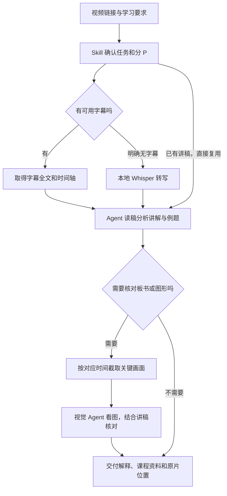

# bili-reach

一个 B站课程分析 skill：**先读完整讲稿，再按需查看关键画面，结合口播、板书和图形分析课程。**

## 安装

通过 [skills CLI](https://github.com/vercel-labs/skills#install-a-skill) 安装：

```sh
npx skills add s0ftnote/bili-study-kit --skill bili-reach
```

## 使用

安装后，直接对你的 agent 说：

> 分析这节 B站课：<视频链接>。先读完整讲稿，遇到板书或图形就看对应画面，帮我梳理讲解和例题。

也可以只提具体要求：

- “取这条视频第 3 P 的完整讲稿。”
- “解释 12 分钟附近这道题，结合板书看。”
- “把这节课整理成带原片时间链接的学习资料。”

## 处理流程



**Skill 串起流程，随附脚本负责取稿和截图，agent 负责分析和识图。** 只取稿或只截图可在对应步骤结束；要入库时再交给通用入库流程。

## 使用条件

安装使用需要 Node.js 22.20+；截图需 FFmpeg，无字幕时的本地转写另需 whisper.cpp 和模型；识图由支持视觉的 agent 完成。skill 自带脚本，无需另行克隆整个项目。

一次处理一个分 P，保留取得的全文与时间轴；不清楚的地方标疑问、回看原片。模型、登录态等按需配置见[取材说明](<skills/bili-reach/references/acquisition.md>)。
