# bili-reach

B 站课程分析：**先读完整讲稿，再按需查看关键画面，结合口播、板书和图形讲清一节课。**

它是 [study-kit](https://github.com/s0ftnote/study-kit) 的一员，也可以单独使用。

## 安装

```sh
npx skills add s0ftnote/study-kit --skill bili-reach
```

## 怎么用

直接对 agent 说：

> 分析这节 B 站课：<视频链接>。先读完整讲稿，遇到板书或图形就看对应画面，帮我梳理讲解和例题。

也可以只提具体要求：

- “取这条视频第 3 P 的完整讲稿。”
- “解释 12 分钟附近这道题，结合板书看。”
- “把这节课整理成带原片时间链接的笔记。”
- “把这节课加进我的学习库。”（取到讲稿后交给 `study-wiki` 入库）

## 处理流程



skill 串起流程，随附脚本负责取稿和截图，agent 负责读稿、看图和讲解。只取稿或只截图时到对应步骤结束。

## 使用条件

- Node.js 22.20+；截图需要 FFmpeg。
- 没有字幕的视频要本地转写，需要 whisper.cpp 和模型，由你自己准备，skill 不会自动下载。
- 看图核对需要能读图片的 agent。
- 一次处理一个分 P。每次截图都会重新下载视频流，所以截图时间点会尽量攒在一起取。

登录态、模型路径、缓存和错误处理见[取材说明](references/acquisition.md)，产物目录结构见[数据契约](references/data-contract.md)。
