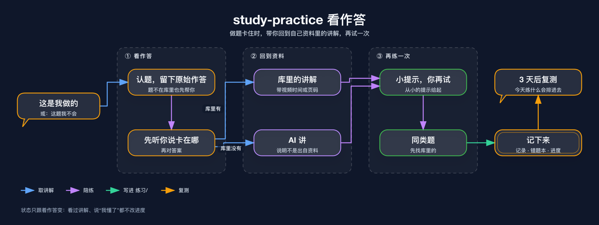
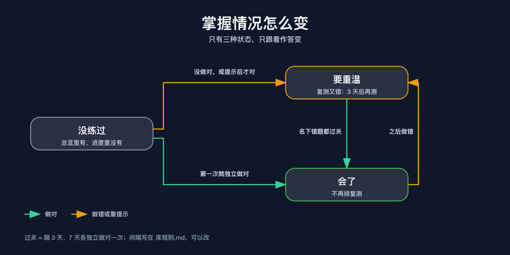

# study-practice

练习与错题记录：你做题，它帮你看清卡在哪、**带你回到自己资料里对应的讲解**、陪你再试一次，然后记进错题本和进度，到期安排复测。

它是 [study-kit](https://github.com/s0ftnote/study-kit) 的一员，只写学习库的 `练习/`；讲解和题目从 `study-wiki` 整理的 `知识/` 里取。

## 安装

```sh
npx skills add s0ftnote/study-kit --skill study-practice
```

它要读 `study-wiki` 建的学习库，建议三个一起装：`npx skills add s0ftnote/study-kit --skill '*'`。

## 怎么用

| 你说 | 它做 |
|---|---|
| “这是我做的，帮我看看”“这题我不会” | 看作答，找卡点，取讲解和同类题，记下来 |
| “帮我对一下答案”，附一整套卷子 | 一次对完，错的再一道道看 |
| “把这张卷子的错题整理一下” | 批改过的卷子逐题进错题本 |
| “这个知识点我不懂” | 只讲，带出处，不记进度 |
| “今天练什么” | 到期复测排最前，按你的时间给 3–5 道 |
| “我现在学得怎么样” | 按章节说哪些会了、哪些要重温 |

## 看作答



## 掌握情况怎么变



状态只跟着作答变：看过讲解、资料入了库、说“我懂了”，都不改进度。复测间隔写在学习库的 `库规则.md` 里，可以改。

## 几条原则

- 先让你想：提示从小给起，你明确要答案才给。
- 讲解先找库里的，带出处；库里没有才由 AI 讲，并说明是 AI 讲的。
- 原始作答留着，记录只往后加。
- 错因、卡点这类推断都标明是推测。
