# study-wiki

学习库的入库与维护：把网课、卷子、书、讲义整理成一个 Obsidian 文件夹里的**来源页、知识点和题目**，挂进学科总览，并能生成思维导图。

它是 [study-kit](https://github.com/s0ftnote/study-kit) 的一员，负责学习库的 `资料/` 和 `知识/`。

## 安装

```sh
npx skills add s0ftnote/study-kit --skill study-wiki
```

B 站视频入库要用到 `bili-reach`，建议三个一起装：`npx skills add s0ftnote/study-kit --skill '*'`。

## 怎么用

| 你说 | 它做 |
|---|---|
| “帮我建一个学习库” | 复制模板，建好第一科的总览 |
| “把这个加进去”，附链接、文件或照片 | 入库：放原件，写来源页、知识点、题目，更新总览 |
| “抽屉原理在哪讲过” | 从总览找到知识点，给出视频时间或页码 |
| “检查一下知识库” | 找断链、重复知识点、没挂进总览的页面 |
| “画个思维导图” | 从总览生成 Obsidian 白板 |
| “换个格式”“加个字段” | 和你一起改 `库规则.md`，再把已有页面整理过去 |

## 入库流程



几条原则：先找后建，同一个东西全库只有一页；每条讲解带出处（视频时间、页码、题号）；看不清的记成待核对；入库不改掌握进度，进度只由 `study-practice` 根据作答来记。

## 学习库长什么样



```text
学习库/
├── 库规则.md       # 目录、命名、每种笔记的模板；想改格式就改这一份
├── 首页.md
├── 日志.md
├── 资料/           # 原件，放进来以后保持原样
├── 知识/<学科>/    # 本 skill 写
│   ├── <学科>总览.md      # 学科 → 章节 → 专题 → 知识点
│   ├── <学科>导图.canvas
│   └── 来源/  知识点/  题目/
└── 练习/           # study-practice 写
```

模板在 [`assets/学习库模板/`](assets/学习库模板/库规则.md)，建库时整个复制过去。格式只写在 `库规则.md` 一处，skill 只管流程，所以改格式不用动 skill。

## 思维导图

```sh
node scripts/mindmap.mjs --overview 知识/数学/数学总览.md --out 知识/数学/数学导图.canvas
node scripts/mindmap.mjs --overview 知识/数学/数学总览.md --progress 练习/进度.md --out 练习/数学薄弱点.canvas
```

第二条只画练过的知识点，要重温标橙、会了标绿。零依赖，Node 18+。详见[导图说明](references/mindmap.md)。
